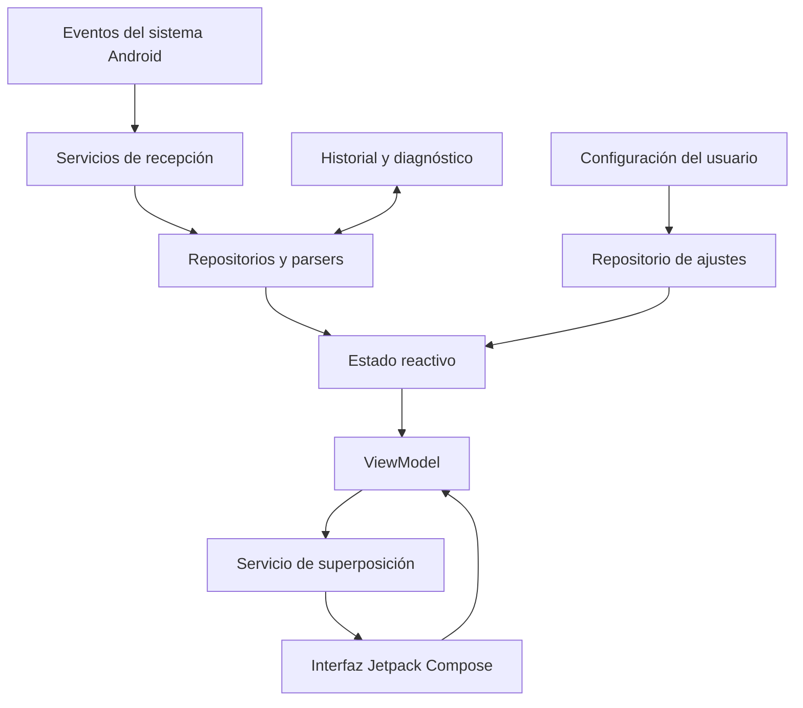

# Arquitectura técnica de Ryx Isla

Este documento resume la arquitectura y los mecanismos técnicos descritos para Ryx Isla. La información procede del análisis técnico proporcionado para el proyecto. Los nombres de clases, paquetes y archivos se muestran como identificadores de implementación: deben coincidir con el código real y no deben renombrarse en la documentación sin modificar también el código.

## 1. Visión general

Ryx Isla utiliza un flujo de datos reactivo y unidireccional. Los eventos del sistema Android —como notificaciones, batería y temporizadores— alimentan repositorios y modelos de estado. La interfaz observa esos estados y actualiza una superposición basada en Jetpack Compose.



## 2. Servicios y mecanismos principales

### 2.1 Recepción y clasificación de notificaciones

El servicio basado en `NotificationListenerService` recibe notificaciones publicadas por Android y las procesa antes de presentarlas en la isla dinámica.

Los mecanismos documentados incluyen:

- Filtrado de notificaciones vacías, alertas del sistema y tareas en segundo plano que no requieren mostrarse.
- Clasificación de llamadas, multimedia, temporizadores, cronómetros, navegación, seguimiento de actividades, progreso y alertas generales.
- Detección de notificaciones Heads-Up y presentación automática en la superposición cuando corresponde.
- Control de claves de notificaciones suprimidas para sincronizar la eliminación con el estado interno.
- Detección de temporizadores y cronómetros de aplicaciones de reloj compatibles.
- Control de ráfagas de notificaciones mediante una ventana temporal y un periodo de enfriamiento.
- Registro local del historial de alertas para consulta y filtrado.
- Vinculación con sesiones multimedia para obtener estado de reproducción, posición y metadatos.

Los detalles de compatibilidad dependen de las aplicaciones emisoras y de la versión de Android.

### 2.2 Ciclo de vida de la superposición

La superposición se administra desde un servicio Android que crea una ventana `TYPE_APPLICATION_OVERLAY` y aloja una vista `ComposeView`.

Entre sus responsabilidades se encuentran:

- Crear, actualizar y retirar la ventana flotante.
- Mantener la interfaz sincronizada con el estado reactivo.
- Adaptar la posición o visibilidad ante cambios de orientación.
- Gestionar el foco de ventana para permitir respuestas en línea cuando la función está disponible.
- Asociar propietarios de ciclo de vida, estado guardado y ViewModel a la vista alojada por el servicio.

### 2.3 Gestión de eventos táctiles

La isla debe permitir la interacción con su contenido sin bloquear innecesariamente las aplicaciones que se encuentran debajo.

El comportamiento documentado diferencia dos estados:

- **Contraído:** limita la región táctil al área de la isla para que el resto de la pantalla siga recibiendo eventos.
- **Expandido:** captura los toques en el área correspondiente para permitir cerrar la tarjeta al tocar fuera de ella.

La implementación contempla el cálculo de límites según densidad, tamaño y desplazamiento, además de compatibilidad con distintas capas de personalización de Android.

### 2.4 Ventanas flotantes y apertura de aplicaciones

La documentación técnica describe una acción para abrir la aplicación de origen de una notificación en modo ventana libre cuando el dispositivo y la versión de Android lo permiten. La disponibilidad de esta capacidad depende del fabricante, del sistema y de las restricciones de ejecución en segundo plano.

## 3. Estado y persistencia

El estado de Ryx Isla se organiza mediante repositorios:

- **Preferencias:** almacenamiento reactivo de posición, dimensiones, colores, visibilidad, duración de ocultación y otras opciones mediante DataStore.
- **Notificaciones activas:** flujo de estado seguro para concurrencia que mantiene sincronizada la lista de notificaciones visibles.
- **Historial:** persistencia local de alertas para consulta dentro de la aplicación.
- **Copia de seguridad:** exportación e importación de preferencias en JSON mediante Android Storage Access Framework.

La restauración de preferencias debe mantener la coherencia del estado y validar los datos importados.

## 4. Interfaz y experiencia de uso

La interfaz está construida con Jetpack Compose y componentes visuales personalizados.

### 4.1 Gestos documentados

**Isla contraída**

- Deslizar a izquierda o derecha para cambiar entre elementos activos o controlar la pista multimedia, según el modo.
- Deslizar hacia arriba o abajo para ejecutar la acción configurada.
- Tocar para expandir la isla.
- Desactivar las acciones por deslizamiento desde la configuración cuando se prefiera una interacción basada en toques.

**Tarjeta expandida**

- Tocar fuera para contraer la isla.
- Deslizar hacia arriba para descartar el elemento activo.
- Mantener y deslizar para descartar varios elementos cuando esa acción esté habilitada.
- Deslizar hacia abajo para cerrar la tarjeta y ejecutar la acción compatible.
- Deslizar horizontalmente para cambiar entre elementos activos.

Los gestos disponibles pueden variar según el tipo de contenido y los ajustes del usuario.

### 4.2 Indicadores compactos

El estado contraído puede mostrar distintos indicadores según el contenido activo:

- Icono de la aplicación, imagen del contacto o carátula multimedia.
- Punto de notificación.
- Duración de llamada.
- Visualizador de audio.
- Estado de batería de dispositivos Bluetooth compatibles.
- Porcentaje de batería y estado de carga.

### 4.3 Elementos gráficos

La documentación técnica identifica componentes gráficos personalizados, entre ellos:

- Indicador circular punteado de carga.
- Barra de progreso musical con animación ondulada.
- Animación de rebote al pulsar controles.
- Animaciones de transición y escala para indicadores dinámicos.

## 5. Pantalla de ajustes

La configuración se organiza en secciones modulares:

| Sección | Responsabilidad |
|---|---|
| Encabezado | Identidad de Ryx Isla y control principal de la superposición. |
| Permisos | Estado de permisos necesarios para las funciones. |
| Posición y tamaño | Dimensiones, radio, desplazamientos y ubicación. |
| Notificaciones y privacidad | Reglas de filtrado, alertas y control de sonidos. |
| Personalización | Paletas, colores, opacidad y sombras. |
| Accesos rápidos | Aplicaciones fijadas o recientes. |
| Gestos | Acciones de la isla contraída y expandida. |
| Copia de seguridad | Exportación, restauración y reinicio de ajustes. |
| Actualizaciones | Consulta de versiones y novedades, si está habilitada. |
| Opciones de desarrollador | Registros y herramientas de diagnóstico. |
| Soporte | Acceso a reportes y solicitudes de mejora. |
| Acerca de | Información de la aplicación y enlaces relacionados. |

## 6. Pruebas

El análisis técnico recibido enumera pruebas para las siguientes áreas:

- Acciones de gestos de la isla.
- Repositorio de notificaciones.
- Correspondencia entre categorías y modos de visualización.
- Prioridad y filtrado de notificaciones.
- Persistencia y restauración de preferencias.
- Eventos de batería y alimentación.
- Creación y visualización de la superposición.

Ejecuta las pruebas disponibles con:

```bash
./gradlew test
```

Las pruebas instrumentadas requieren un dispositivo o emulador compatible.

## 7. Configuración de compilación documentada

| Elemento | Valor |
|---|---|
| Sistema de compilación | Gradle Kotlin DSL |
| Interfaz | Jetpack Compose y Material 3 |
| Ciclo de vida | AndroidX Lifecycle |
| Concurrencia | Kotlin Coroutines |
| Persistencia de preferencias | DataStore |
| Inyección de dependencias | Dagger Hilt |
| SDK mínimo | 26 (Android 8.0) |
| SDK objetivo | 36 |
| SDK de compilación | 36 |
| Version code documentado | `8` |
| Version name documentado | `7.0.0` |

Verifica los valores en los archivos Gradle antes de publicar. Este documento no sustituye la configuración real del proyecto.
