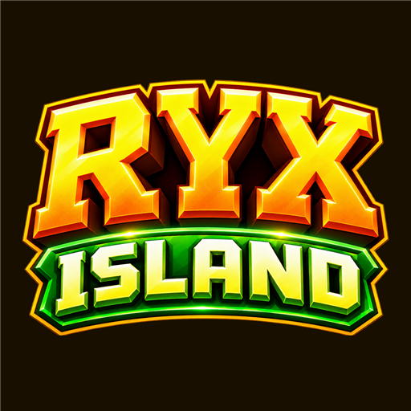
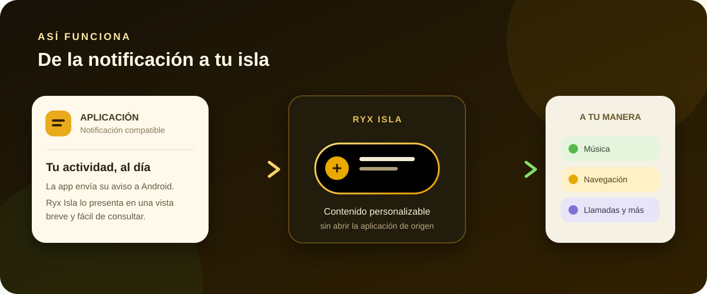
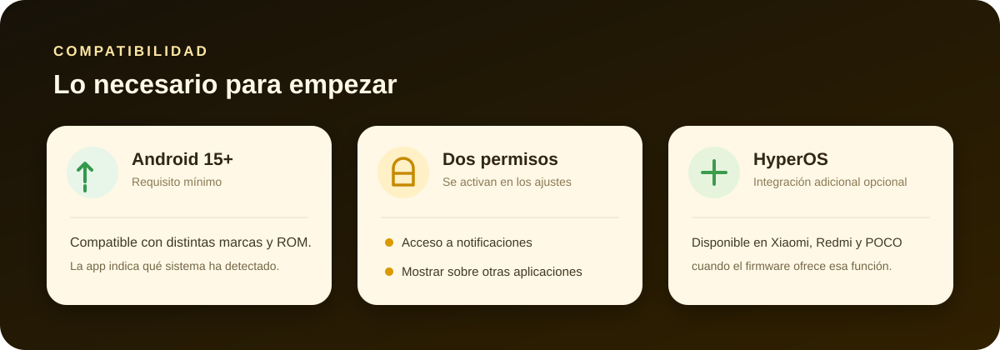

<div align="center">



# Ryx Isla

### Tus notificaciones, reunidas en una isla dinámica.


<br />

[⬇️ Descargar APK](https://github.com/davidft1joel431/Island-app-Ryx/releases/latest/download/RyxIsla.apk) · [📋 Ver versiones](https://github.com/davidft1joel431/Island-app-Ryx/releases) · [🐛 Informar de un problema](https://github.com/davidft1joel431/Island-app-Ryx/issues)

</div>

---

Ryx Isla convierte notificaciones compatibles en una isla flotante personalizable. Reúne música, navegación, llamadas, descargas y mensajes en una experiencia visual inspirada en Hyper Island.

## 🔔 ¿Cómo funciona?



1. 📲 Eliges qué aplicaciones pueden enviar avisos a la isla.
2. 🔐 Concedes acceso a las notificaciones y permiso para mostrar contenido sobre otras aplicaciones.
3. ✨ Ryx Isla presenta la información activa en una isla flotante que puedes personalizar.

## ✨ Funciones principales

| Función | Qué puedes hacer |
| --- | --- |
| 🎵 Contenido multimedia | Ver la reproducción y la carátula cuando la aplicación de música las incluye en su notificación. |
| 🧭 Navegación | Consultar indicaciones y progreso de viaje de aplicaciones compatibles. |
| 📞 Llamadas | Mantener a la vista la información de llamadas compatibles. |
| 📥 Descargas y tareas | Seguir el progreso de notificaciones compatibles. |
| 🎨 Apariencia | Ajustar colores, formas, temas y diseño de la isla. |
| 🧩 Widgets | Añadir widgets compatibles y personalizar su presentación. |
| ⚙️ Control por aplicación | Elegir qué aplicaciones y tipos de aviso aparecen. |
| 🛡️ Privacidad | El procesamiento de notificaciones se realiza en el dispositivo. |

La información visible depende del contenido que envíe cada aplicación. La isla no puede inventar datos que no vengan en la notificación.

## 📱 Compatibilidad



| Sistema | Compatibilidad |
| --- | --- |
| Android 15 o posterior | Requisito mínimo de esta versión. |
| Otras marcas y ROM | Ryx Isla dibuja la isla con una ventana flotante de Android; el ahorro de batería y las reglas en segundo plano varían según el fabricante. |
| Xiaomi, Redmi y POCO con HyperOS | Pueden ofrecer integración nativa adicional con notificaciones destacadas. |
| Permisos | Debes habilitar el acceso a notificaciones y permitir que Ryx Isla se muestre sobre otras aplicaciones. |

Durante la configuración, la app muestra el fabricante, la ROM detectada y la versión/API de Android para que puedas revisar el estado de tu dispositivo.

## 🚀 Instalación y primeros pasos

1. Descarga la versión más reciente desde [GitHub Releases](https://github.com/davidft1joel431/Island-app-Ryx/releases/latest).
2. Instala el archivo `RyxIsla.apk` en un dispositivo con Android 15 o posterior.
3. Abre Ryx Isla y completa la comprobación de compatibilidad.
4. Activa **Acceso a notificaciones** y **Mostrar sobre otras aplicaciones** cuando Android lo solicite.
5. Selecciona tus aplicaciones y ajusta el diseño de la isla.

💡 Si la isla deja de aparecer, revisa la pantalla **Compatibilidad del sistema** y permite la actividad en segundo plano en los ajustes de batería del teléfono.

## 🧱 Compilar desde el código fuente

Abre el proyecto en Android Studio o ejecuta en PowerShell:

```powershell
.\gradlew.bat assembleDebug
```

Se necesita **JDK 21** y **Android SDK 36**. El APK de depuración se genera en `app/build/outputs/apk/debug/`.

## 👤 Autoría y licencias

- ✍️ Creador de Ryx Isla: **David Joel**, Perú.
- 🌱 Proyecto de origen: [Hyper Bridge](https://github.com/D4vidDf/HyperBridge), de D4vidDf.
- 📜 Licencia del proyecto de origen: [Apache 2.0](LICENSE). Los avisos y cambios de Ryx Isla están en [NOTICE.md](NOTICE.md).

Ryx Isla es un proyecto independiente derivado de Hyper Bridge. Conserva la atribución y licencia del código de origen.
