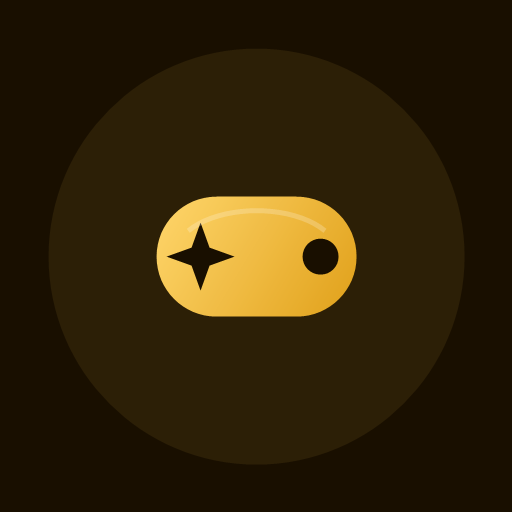
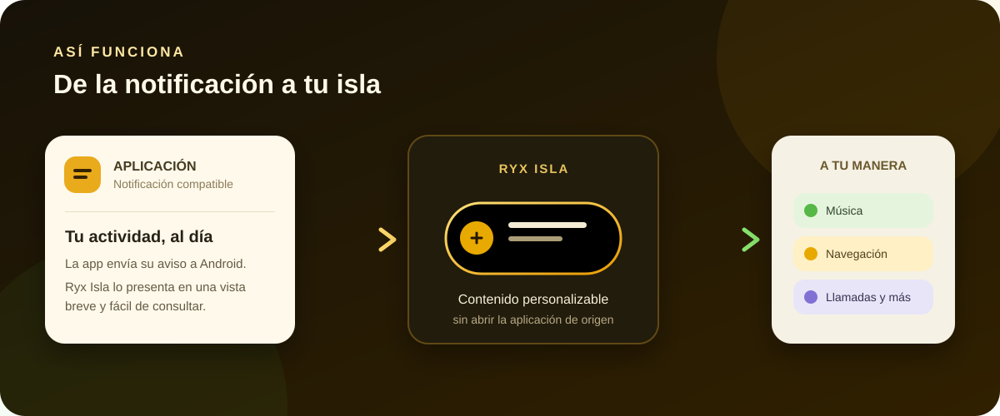
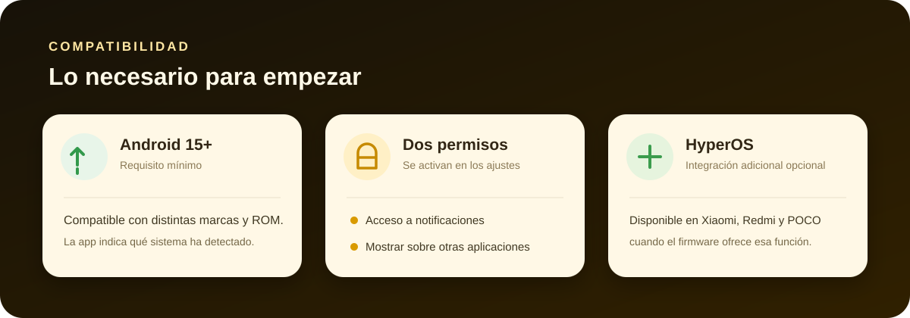

<div align="center">



# Ryx Isla

### Tus notificaciones, reunidas en una isla dinámica.

<p>
  
  
  
  
</p>

[⬇️ **Descargar APK**](https://github.com/davidft1joel431/Island-app-Ryx/releases/latest/download/RyxIsla.apk)
· [📋 Versiones](https://github.com/davidft1joel431/Island-app-Ryx/releases)
· [🐛 Reportar un problema](https://github.com/davidft1joel431/Island-app-Ryx/issues)

</div>

---

## ✨ Una isla, toda tu actividad

Ryx Isla transforma las notificaciones compatibles en una isla flotante, práctica y personalizable. Consulta música, navegación, llamadas, descargas y mensajes sin perder de vista lo que ocurre en tus aplicaciones.

<div align="center">


<sub>Vista conceptual animada de la experiencia de Ryx Isla. La información mostrada depende de cada aplicación compatible.</sub>

</div>

## 🔔 ¿Cómo funciona?



1. 📲 Selecciona qué aplicaciones pueden mostrar avisos en la isla.
2. 🔐 Concede el acceso a las notificaciones y el permiso para mostrarse sobre otras aplicaciones.
3. ✨ Ryx Isla presenta la actividad compatible en una isla flotante que puedes adaptar a tu estilo.

## 🚀 Funciones principales

| Función | Descripción |
|:--|:--|
| 🎵 **Contenido multimedia** | Consulta la reproducción y la carátula cuando la aplicación de música las incluye en su notificación. |
| 🧭 **Navegación** | Visualiza indicaciones y progreso de viaje de aplicaciones compatibles. |
| 📞 **Llamadas** | Mantén a la vista la información de llamadas compatibles. |
| 📥 **Descargas y tareas** | Sigue el progreso de las notificaciones compatibles. |
| 🎨 **Personalización** | Ajusta colores, formas, temas y diseño de la isla. |
| 🎛️ **Posición y animaciones** | Configura la altura, alineación y comportamiento visual de la isla flotante. |
| 🔔 **Historial** | Consulta y elimina las notificaciones recientes mostradas por la isla. |
| 🧩 **Widgets** | Añade widgets compatibles y personaliza su presentación. |
| ⚙️ **Control por aplicación** | Decide qué aplicaciones y tipos de avisos aparecen. |
| 🛡️ **Privacidad** | El procesamiento de las notificaciones se realiza en el dispositivo. |

> **Importante:** Ryx Isla muestra los datos que recibe de las aplicaciones. La disponibilidad de cada función depende del contenido de sus notificaciones y de la compatibilidad del sistema.

## 📱 Compatibilidad



| Requisito | Detalle |
|:--|:--|
| **Sistema operativo** | Android 15 o posterior. |
| **Dispositivos** | Marcas y ROM basadas en Android 15 o posterior. |
| **Permiso de notificaciones** | Necesario para leer y presentar los avisos seleccionados. |
| **Mostrar sobre otras aplicaciones** | Necesario para visualizar la isla flotante. |

Durante la configuración, la aplicación muestra el fabricante, la ROM detectada y la versión/API de Android para que puedas comprobar el estado de tu dispositivo.

## 🧩 Inspiración visual

Ryx Isla toma como referencia el concepto de las islas dinámicas y las experiencias de notificación de **HyperOS**. La propuesta busca reunir información útil en una interfaz compacta, fluida y personalizable.

La apariencia de Ryx Isla es un desarrollo independiente: no es una aplicación oficial de Xiaomi ni está afiliada a Xiaomi o HyperOS.

## 📦 Instalación

1. Descarga la versión más reciente desde [GitHub Releases](https://github.com/davidft1joel431/Island-app-Ryx/releases/latest).
2. Instala `RyxIsla.apk` en un dispositivo con Android 15 o posterior.
3. Abre Ryx Isla y completa la comprobación de compatibilidad.
4. Activa **Acceso a notificaciones** y **Mostrar sobre otras aplicaciones** cuando Android lo solicite.
5. Selecciona las aplicaciones que quieras y personaliza tu isla.

💡 **¿La isla no aparece?** Revisa la pantalla **Compatibilidad del sistema** y comprueba que el teléfono permita la actividad en segundo plano en los ajustes de batería.

## 🛠️ Compilar desde el código fuente

Puedes abrir el proyecto en Android Studio o compilarlo desde PowerShell:

```powershell
.\gradlew.bat assembleDebug
```

**Requisitos de compilación:**
- JDK 21
- Android SDK 36

El APK de depuración se genera en:

```text
app/build/outputs/apk/debug/
```

## 👤 Autoría, inspiración y licencias

- **Proyecto:** Ryx Isla.
- **Creador de Ryx Isla:** David Joel.
- **Inspiración:** Hyper Bridge y el concepto de isla dinámica de HyperOS.
- **Licencia:** consulta [`LICENSE`](LICENSE) y [`NOTICE.md`](NOTICE.md) para conocer las condiciones y los avisos de atribución correspondientes.

Ryx Isla es un proyecto independiente. La mención de Hyper Bridge indica una referencia de inspiración y no implica afiliación con sus autores ni con Xiaomi. Los avisos de autoría y licencia que correspondan al código de origen se mantienen en `NOTICE.md`.

## 🔄 Actualizaciones

Ryx Isla comprueba si existe una versión nueva en su repositorio oficial de GitHub al iniciar la aplicación. También puedes iniciar la comprobación desde **Ajustes > Buscar actualizaciones**.

El diálogo muestra las novedades y permite abrir la descarga publicada en [GitHub Releases](https://github.com/davidft1joel431/Island-app-Ryx/releases). Esta comprobación utiliza el repositorio oficial de Ryx Isla y no depende de HyperOS, Xiaomi ni de proyectos externos.

---

<div align="center">

**Ryx Isla** · Una forma más clara de ver lo que sucede en tu Android.

<sub>Hecho con dedicación. Personaliza tu isla y disfruta la experiencia.</sub>

</div>
