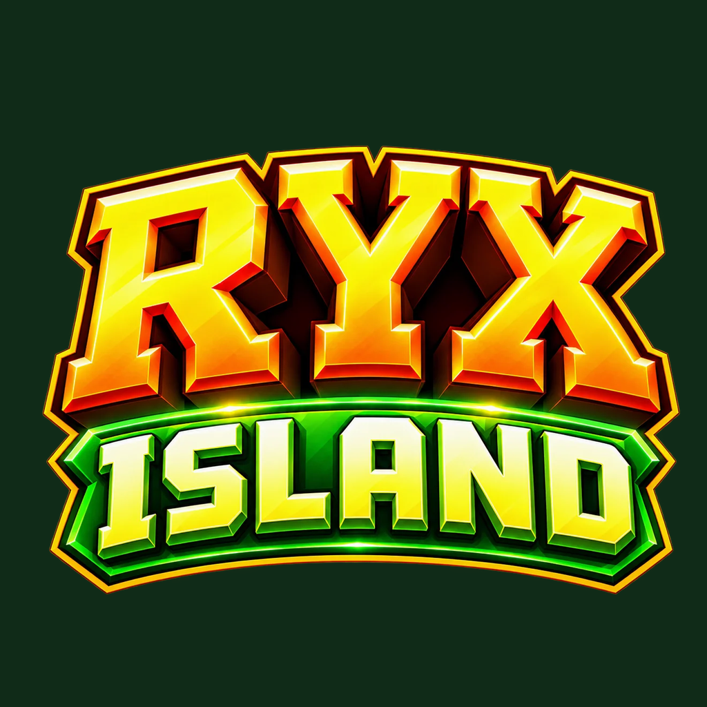

<div align="center">



# Ryx Isla

### Tu isla dinámica, tus notificaciones y tus accesos rápidos en un solo lugar.

[](https://www.android.com/)
[](https://openjdk.org/)
[](https://developer.android.com/)
[](LICENSE)

**Ryx Isla** es una aplicación para Android que incorpora una experiencia de isla dinámica mediante una superposición configurable. Reúne información y controles importantes para que puedas acceder a ellos sin perder de vista lo que estás haciendo.

Los accesos rápidos detectan y abren aplicaciones clonadas mediante los perfiles de Android. En PalapaOS, PixelOS y LineageOS aparecerán cuando la ROM exponga esos perfiles a `LauncherApps`; no depende de una función exclusiva de HyperOS.

</div>

---

## ✨ Características

Ryx Isla integra distintas funciones del sistema Android en una interfaz de isla dinámica:

- 🔔 **Notificaciones:** visualización de notificaciones compatibles.
- 🎵 **Controles multimedia:** acceso a la información y los controles de reproducción.
- 📞 **Llamadas:** indicadores relacionados con llamadas.
- ⏱️ **Temporizadores:** información de temporizadores activos.
- 🧭 **Navegación:** información de navegación compatible.
- ⚙️ **Eventos del sistema:** avisos y estados del dispositivo.
- 🧩 **Widgets y accesos rápidos:** elementos útiles desde la superposición.
- 🎨 **Interfaz configurable:** experiencia adaptable a las preferencias de uso.

> La disponibilidad de algunas funciones puede depender de la versión de Android, los permisos concedidos y la compatibilidad de cada aplicación.

## 📱 Captura / identidad visual

<div align="center">
  
  <br>
  <sub>Icono de Ryx Isla</sub>
</div>

## 🚀 Instalación

Puedes instalar Ryx Isla mediante un APK distribuido por el proyecto.

1. Descarga el archivo APK desde la sección **Releases** del repositorio, si hay una versión publicada.
2. Abre el APK en tu dispositivo Android.
3. Si Android lo solicita, autoriza temporalmente la instalación desde esa fuente.
4. Completa la instalación y concede los permisos que la aplicación necesite para sus funciones.

**Importante:** instala APKs únicamente desde fuentes en las que confíes. Si ya tienes una versión de Ryx instalada, esta versión conserva el identificador de paquete `com.dav.isla` para permitir la actualización de la instalación existente.

## 🛠️ Compilar desde el código fuente

### Requisitos

- **JDK 17**
- **Android SDK 36**
- **Gradle Wrapper** incluido en el repositorio

### Windows

Desde la carpeta raíz del proyecto, ejecuta:

```bat
gradlew.bat assembleDebug
```

### Linux / macOS

```bash
chmod +x gradlew
./gradlew assembleDebug
```

El APK de depuración se genera normalmente en:

```text
app/build/outputs/apk/debug/app-debug.apk
```

Si la compilación falla, comprueba que JDK 17 esté configurado correctamente y que Android SDK 36 esté instalado.

## 🧱 Tecnologías y compatibilidad

| Elemento | Información |
|---|---|
| Plataforma | Android |
| JDK requerido | 17 |
| Android SDK | 36 |
| Identificador de paquete | `com.dav.isla` |
| Compilación | Gradle Wrapper |

## 📄 Licencia y atribuciones

Ryx Isla es un proyecto independiente inspirado en [Smart Island](https://github.com/agupta07505/SmartIsland), de **Animesh Gupta**. El proyecto conserva componentes de **Smart Island 7.6.0** y sus correspondientes avisos de autoría y licencia.

El código derivado se distribuye bajo los términos de **GNU General Public License v3.0 (GPL-3.0)**. Antes de modificar o redistribuir el proyecto, revisa estos documentos:

- [LICENSE](LICENSE) — términos de la licencia.
- [UPSTREAM.md](UPSTREAM.md) — información del proyecto de origen.
- Avisos de terceros incluidos en el repositorio.

Ryx Isla **no es un producto oficial de Xiaomi** ni de Animesh Gupta. Los nombres y marcas de terceros pertenecen a sus respectivos propietarios.

## 🤝 Contribuciones

Las sugerencias, reportes de errores y mejoras son bienvenidos. Antes de enviar cambios:

1. Revisa la licencia y los avisos de atribución.
2. Describe claramente el cambio o problema.
3. Incluye los pasos para reproducir cualquier error reportado.

## ⭐ Apoya el proyecto

Si Ryx Isla te resulta útil, puedes apoyar su desarrollo dejando una ⭐ en el repositorio y compartiéndolo con otras personas.

---

<div align="center">
  <sub>Hecho para Android · Ryx Isla</sub>
</div>
